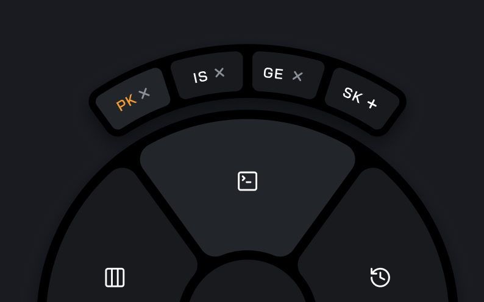

## Description

Relay Runner now has four fixed agents (see RR-519): Puck, Isabella, George and Sky, in that order. Stopping an agent keeps its conversation and starting it again resumes it.

The session wheel (four-finger tap; `docs/session-wheel.md`) still shows the old tab model: hovering the top (session) segment reveals one segment per open tab, each with an x, followed by an **Add tab** plus. Clicking the top segment starts a session when none is running.

The user wants the submenu to be the one place on the wheel where sessions start and stop, and to always show all four agents.

### Code (verify before relying on it)

- `Sources/relay-runner/Board/SessionWheelModel.swift`: `SessionWheelTab`, `SessionWheelTabControl` (`.add`), `SessionWheelSessionItem`, `sessionItems`, `isStartSlot`, geometry constants `sessionStandardItems`, `sessionMaxItems`, `sessionSubmenuSpan`, and the entering-tab growth (`SessionTabEntry`, `sessionWeight`).
- `SessionWheelView.swift`: `tabItemButton`, `tabCloseButton`, the "Terminal" / "Start session" title.
- `SessionWheelController.selectSlot`: `focusSession` when a session runs, otherwise `startSession`.
- `AppState.refreshSessionWheel` and `performTabWheelAction` (tab → `selectPMTab`, close → `removePMTab`, add → `openPMTab`).
- Tests: `tests/RelayRunnerTests/SessionWheelTests.swift`, `SessionWheelMotionTests.swift`, `SessionWheelHapticsTests.swift`.

### What to build

1. **Four fixed segments.** Hovering the session segment always reveals exactly four segments, in order: Puck, Isabella, George, Sky. They are there whether or not any session is running. There is no Add tab control. The user's mockup is attached (see Attachments) and is the visual reference: match it.
   - Each segment shows a two-letter label followed by one glyph, in reading order, as today's tab segments show a label and an x: **PK**, **IS**, **GE**, **SK**. Add this short label to the agent definition; full names are still used in the notch, VoiceOver and everywhere outside the wheel.
   - The four segments sit over the session's own cell in the submenu's standard size, on the detached black backdrop, with the existing segment corners and spacing.
2. **Plus or X.** An agent that is not running shows a plus in the primary text colour, as SK does in the mockup. A running agent shows an X in the secondary (grey) text colour, as PK, IS and GE do. The glyph changes in place when the agent starts or stops. A stopped agent's label is in the primary text colour, not dimmed: the plus is what marks it as stopped.
3. **Starting.** Clicking the name or the plus of an agent that is not running starts it, resuming its last conversation, and makes it the active agent. This works when no session is running at all: it is how a session starts from the wheel. The start does not open Workspace, as the wheel's start does not today.
4. **Switching.** Clicking the name of a running agent makes it the active agent (voice turns, replies and TTS go to it), as clicking a tab label does today. The active agent's label is orange, as PK is in the mockup; its X stays grey.
5. **Stopping.** Clicking a running agent's X stops it and keeps its conversation. Stopping the active agent moves activity to another running agent; stopping the last running agent ends the session, as today.
6. **Top segment.** Clicking the session segment itself always opens Workspace on the Terminal tab and never starts a session, whether or not one is running. Its title is always "Terminal". With no session running, the Terminal tab shows its normal empty state.
7. **Notch and VoiceOver.** Hovering names the action in one to three words: "Start Puck", "Switch to Puck", "Stop Puck". Each segment and glyph is a VoiceOver action on the session slot with the same wording.
8. **Geometry.** Four segments fit the submenu's standard size over the session's own cell. Remove the code that grows the submenu past its cell for more than five tabs and the entering-tab growth animation, since the count no longer changes. Keep the liquid submenu entrance, Reduce Motion handling and haptics.
9. **Docs.** Rewrite the session submenu section of `docs/session-wheel.md` to match.

All wheel actions keep the wheel open, as now.

## Acceptance criteria

- [ ] Model test: with no session running, `sessionItems` is the four agents in order, each not running, and there is no add control.
- [ ] Segment labels are PK, IS, GE and SK, from a short label on the agent definition; a test pins them.
- [ ] The glyph and label colours follow the attached mockup: grey X for running, primary-colour plus for stopped, orange label for the active agent, no dimmed labels.
- [ ] Model test: a running agent's item reports the X (stop) glyph and a stopped one the plus (start) glyph; the active agent is marked selected.
- [ ] Test: clicking a stopped agent's name and clicking its plus both request a start of that agent; clicking a running agent's name requests a switch; clicking its X requests a stop.
- [ ] Test: selecting the session slot with no session running opens the Terminal tab and does not start a session; `isStartSlot` behaviour is gone or always false.
- [ ] Test: hover titles are "Start <name>", "Switch to <name>" and "Stop <name>" for the three cases.
- [ ] The submenu span is one cell for the four segments; the growth constants and entering-tab code are removed along with their tests.
- [ ] Reduce Motion and haptics tests pass.
- [ ] `docs/session-wheel.md` describes the new submenu and top-segment behaviour and no longer mentions Add tab, S1/S2 labels or nine tabs.
- [ ] The Swift test suite passes (report the command and counts in the run log).
- [ ] The run log states that the wheel was not checked visually in a running app by the worker and is left for the user.

## Attachments

- 
