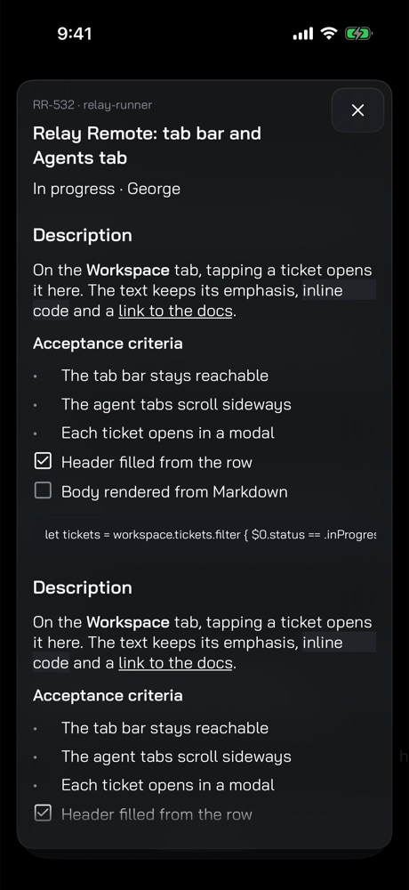

# Relay Remote (iOS): final design reference

The design for the Relay Remote iPhone app, as agreed with the user on 2026-11-26. Build tickets RR-532 onward implement it. The images in this folder are 2x exports of the final Figma screens (402 × 874 pt phone frame).

- **Figma source:** file `IGjwpE5m7vLaCThHgoy0cw` ("Relay-Runner"), page "Application", section "Relay Remote (iOS) · Final" (node `2139:37371`). Sections marked "(superseded by Final)" are old; ignore them.
- **Link to a screen:** `https://www.figma.com/design/IGjwpE5m7vLaCThHgoy0cw/Relay-Runner?node-id=<node id with - instead of :>`
- If the Figma tools are not available to you, the images and this file are enough. Where an image and this text disagree, this text wins; where neither answers a question, match the desktop app.

## Screens

| # | Screen | Figma node | Image |
|---|---|---|---|
| 01 | Splash · R | 2139:37375 | `01-splash-r.png` |
| 02 | Splash · Relay Runner | 2139:37391 | `02-splash-relay-runner.png` |
| 03 | Splash · Glow rises | 2139:37407 | `03-splash-glow-rises.png` |
| 04 | Splash · First thing's first | 2139:39649 | `04-splash-first-things-first.png` |
| 05 | Splash · Permissions | 2139:39665 | `05-splash-permissions.png` |
| 06 | Microphone | 2139:39682 | `06-permission-microphone.png` |
| 07 | Microphone · iOS prompt | 2139:39701 | `07-permission-microphone-ios-prompt.png` |
| 08 | Speech recognition | 2139:39730 | `08-permission-speech-recognition.png` |
| 09 | Local network | 2139:39749 | `09-permission-local-network.png` |
| 10 | Camera | 2139:39768 | `10-permission-camera.png` |
| 11 | Notifications | 2139:39787 | `11-permission-notifications.png` |
| 12 | Pair · Start | 2139:39807 | `12-pair-start.png` |
| 13 | Pair · Scan the code | 2139:39826 | `13-pair-scan.png` |
| 14 | Pair · Check fingerprint | 2139:39855 | `14-pair-check-fingerprint.png` |
| 15 | Tutorial · Basics | 2139:39906 | `15-tutorial-basics.png` |
| 16 | Tutorial · Hold to talk | 2139:39923 | `16-tutorial-hold-to-talk.png` |
| 17 | Tutorial · Release to send | 2139:39989 | `17-tutorial-release-to-send.png` |
| 18 | Tutorial · Play the reply | 2139:41674 | `18-tutorial-play-the-reply.png` |
| 19 | Tutorial · Stop playback | 2139:41749 | `19-tutorial-stop-playback.png` |
| 20 | Tutorial · All done | 2139:44039 | `20-tutorial-all-done.png` |
| 21 | Agents · Ready | 2139:44056 | `21-agents-ready.jpg` |
| 22 | Agents · Holding to talk | 2139:44337 | `22-agents-holding-to-talk.jpg` |
| 23 | Agents · Playing back | 2139:46237 | `23-agents-playing-back.jpg` |
| 24 | Agents · Agent not running | 2139:48749 | `24-agents-agent-not-running.jpg` |
| 25 | Agents · Mac unreachable | 2139:48996 | `25-agents-mac-unreachable.jpg` |
| 26 | Workspace | 2139:49283 | `26-workspace.jpg` |
| 27 | Settings (full scroll length) | 2139:49386 | `27-settings.jpg` |
| 28 | Notification · Lock screen | 2139:49523 | `28-notification-lock-screen.jpg` |
| Board | Styles (tokens, buttons, status glyph, banners) | 2139:67622 | `styles-board.jpg` |

## App flow

First launch: splash (01–05) → permissions (06–11) → pairing (12–14) → tutorial (15–20) → the app (21 onward). Later launches go straight to the app when the phone is paired, and to pairing when it is not. The app has three tabs, mirroring the desktop: Agents, Workspace, Settings.

## Style

- Black background. Typeface Bai Jamjuree (the desktop app's typeface; bundle it in the app).
- Panels: `#0c0f13` at 50% with a glass effect, corner radius 16.
- Buttons: one primary (white) button per screen at most. Secondary buttons are glass (`#171a1e` at 75%). A danger button is the secondary surface with a red (`#f41509`) label and icon, never a red fill.
- Icons are outline (stroke) Lucide icons everywhere, including the chips in the tutorial text. Never filled shapes.
- No coloured status lights or pills anywhere. Agent status is shown only by the four-dot status glyph and the header blob.
- Copy is brief: subtitles are one short line or absent.
- Alert and status banners (for example "Mac unreachable") float over everything in the app except the system status bar. They never push content down.

## Onboarding layout rules (splash, permissions, pairing, tutorial)

- Hero text: Bai Jamjuree Regular 28/40, white, anchored at y 300 and growing downward. It sits in the same place on every screen and is never re-centred when the content changes.
- Each hero line ends with a " /" cursor that pulses between 50% and 100% opacity on a 0.8 s cycle.
- Line breaks are set by hand so no single word wraps onto a line of its own.
- Skip ("Skip →") is always top right.
- The primary button is full width (370 × 52 on a 402 pt screen, 16 pt side margins) with 40 pt below it. Secondary actions sit directly above it.

### Splash (01–05)

A port of the desktop intro, `Sources/relay-runner/Onboarding/OnboardingIntroController.swift`:

1. "R/" holds for 0.7 s.
2. "Relay Runner /" types out at one character every 0.029 s.
3. The purple dot field fades up from the bottom over 4 s (smoothstep), covering the bottom 44%.
4. "First thing's first /" holds for 1.05 s.
5. "I need a few permissions /" holds for 1.4 s.

Each line swap is a 0.24 s fade with a blur to 6 pt and a scale to 96%. A tap skips the splash. With Reduce Motion on, the splash is skipped entirely.

### Permissions (06–11)

Order: microphone, speech recognition, local network, camera, notifications. Each step has one primary button that triggers its iOS prompt (07 shows the system prompt over the step), and Skip moves on without asking. Notifications is requested with `UNUserNotificationCenter.requestAuthorization`; the others have usage strings in `ios/RelayRemote/Info.plist`. Bluetooth is not asked for: headset microphones work through the audio session.

### Pairing (12–14)

1. **Start:** "Now let's pair with your Mac /", a hint "Relay Runner › Settings › Relay Remote", primary "Scan pairing code".
2. **Scan:** "Scan the code on your Mac /", a camera viewfinder, secondary "Paste code".
3. **Check:** "Check it matches your Mac /", the Mac card with a 3-group fingerprint, "Waiting for your Mac · Expires in 9:42" (a live countdown), and Cancel.

Pairing steps have no Skip: the app can do nothing until it is paired.

### Tutorial (15–20)

A port of `Sources/relay-runner/Onboarding/OnboardingSessionControlsTutorial.swift` to the phone's controls:

1. "Now let's learn the basics /", shown while speech gets ready.
2. "[mic Hold to talk] & say hi /"
3. "Now release to send /"
4. "Wait for a reply, then tap [▶ Play] /"
5. "Tap [■] to stop playback /"
6. "You're all done /", then straight into the app. There is no Workspace step.

Each step advances only when the user does the action; there are no Next buttons. The real dock and tab bar sit at the bottom. The control the step targets stays lit and every other control is dimmed to 30%. The bracketed chips look like the real controls (same outline icons). The word "Hold" is not repeated before the "Hold to talk" chip.

## Agents tab (21–25)

- The tab opens straight into the selected agent's chat. There is no nested chat view and no project picker; agents infer the project from the conversation.
- Bottom to top: tab bar; the dock (text box, then a row of Replay, a wide "Hold to talk", and Stop; Replay and Stop are slim 44 pt squares); a horizontally scrollable strip of agent tabs (Puck, Isabella, George, Sky) styled like the desktop terminal tabs.
- The dock is pinned just above the tab bar. As the text box fills while the user speaks it grows upward; it never overlaps the tab bar.
- **Header:** just the agent's blob over the agent's name. No Mac subtitle.
- **Blob:** a port of the desktop Settings agent-card orb, `buildOrbGrid` in `Sources/relay-runner/Overlay/ParticleFieldRenderer.swift`: three Gaussian lobes on a halftone dot grid with a white core (168 × 112 pt, 7 pt grid in the design). Its edge colour follows the agent's state: orange when listening, blue-purple when playing back, navy `#11161D` when idle. It is never dimmed, even when the agent is not running. No blob and no glow inside the agent tabs.
- **Status glyph** next to each agent name in the tab strip: the desktop four-dot glyph from `NotchStatusController.swift`. Static white when ready, spinning when working, orange `#f2700c` when listening, purple `#2b11e8` when playing back. A stopped agent shows one grey (`#596069`) 3 pt dot; when the agent comes online the dot splits into the four.
- **Speech input:** while the user holds, the transcript fills the text box. Releasing sends it as a normal message. "Hold to talk" has a plain pressed state, not purple.
- **Replies:** in Queue mode a new reply shows "New reply from <agent>" with a secondary Play; in Auto-play mode it plays at once.
- **Chat feed:** fades out at its top and bottom edges with an alpha mask on the feed itself (not a black overlay), so the glows show through.
- **Agent not running (24):** "<Agent> isn't running", a secondary "Start <Agent>" button and "Message <Agent> to start it." Sending a message also starts the agent.
- **Mac unreachable (25):** a floating banner at the top with Retry. The chat and controls dim until the Mac is back.

## State glows, app-wide (22, 23, 17, 19)

A port of `buildDotGrid` in `ParticleFieldRenderer.swift` on an 8 pt grid, slightly brightened for the phone.

- **Listening:** while the user is talking, the orange field (desktop STT colours: hue 0.04, saturation 0.95) covers the bottom 32% of the screen.
- **Playback:** while a reply plays, the purple field (desktop TTS colours: hue 0.68, saturation 0.80) covers the bottom 44%.
- Both sit behind all UI, including the tab bar, dock and text box, and appear everywhere in the app, not only in the tutorial.

## Workspace tab (26)

Tickets grouped by status: In progress, Queued, Backlog. Each row shows the ticket and the agent that owns it. Above the tab bar is a scrollable strip of project tabs: All, then one per project, styled like the agent tabs. These are tabs, not filter chips. There is no page title.

## Ticket modal (opens from a Workspace row)

There is no Figma screen for this; it is built from the styles above and the screen is `ios/RelayRemote/MainApp/TicketModalView.swift` on the reusable `RelayModal` (`DesignSystem/RelayModal.swift`, shown on the gallery's Modal page). It is the app's first modal. It is read-only: no editing, dispatching, cancelling or commenting from the phone.

- **Surface.** One glass panel (`relayGlass(.panel)`, radius 16), 16 pt in from each side, starting 16 pt below the status bar and ending 40 pt above the bottom of the screen, the full-width buttons' gap. It hugs a short ticket and is centred in that space; a long one fills it and scrolls inside the panel. No system sheet, detents, drag indicator or pushed screen.
- **Scrim.** Black at 60% over the whole app except the status bar: the tab bar, the project tab strip and the state glows are all under it. The list stays visible, and does not scroll or take taps. A pushed banner (Mac unreachable) is drawn above the scrim and the panel.
- **Close.** A 44 pt secondary glass icon button with the stroke X (Lucide) at the panel's top right, pinned while the body scrolls. A tap on the scrim, a drag down past a third of the panel's height or a fast flick (while the body is at its top) and VoiceOver's escape gesture close it too. While dragging the panel follows the finger and the scrim fades with it. The list is as it was: same scroll position, same project tab.
- **Motion.** `RelayMotion.swap` (0.24 s): the panel fades and scales from 96% and the scrim fades. With Reduce Motion, fade only.
- **Header**, left of the close button: the ticket id and project name on one caption line; the title (card title); the status in words (In progress, Queued, Backlog, Done) and the owning agent's name when there is one. No page title and no pills or lights.
- **Body**, from the ticket's Markdown: headings (24, 18 and 16 semibold by level), paragraphs, bulleted and numbered lists, task items as unticked or ticked boxes (outline icons, read-only), inline code on the secondary surface, code blocks on the secondary surface that scroll sideways rather than wrap, bold (SemiBold), italics and links (underlined, open in the system browser). Bai Jamjuree, white on the panel, and it follows Dynamic Type. The body scrolls under the fixed header and fades out at its top and bottom edges with an alpha mask, not a black overlay.
- **States.** Loading: the header from the list row at once, only the body waits. Error: one short line and Retry, a secondary button; the modal has no primary button. Truncated: "Open on your Mac to read the rest." after the text. Older Mac: "Ticket text is not available on this Mac." and no Retry. Mac unreachable: the floating banner, with the last loaded text dimmed beneath it.
- **Live.** The text is asked for each time the ticket is opened and on pull to refresh. While it is open a pushed Workspace list updates the header's status and agent; if the ticket leaves the open list the header says Done and the text stays.
- **Debug.** `--ticket-sample=<short|long|loading|error|truncated|unsupported|done>` opens it on sample data (with `--workspace-sample=unreachable` for the banner), and `--gallery=modal` shows the component.

## Settings tab (27)

No page title.

- **Voice:** Remote mode; Talk: Hold / Toggle (there is no hands-free mode); Replies: Auto-play / Queue; Reply notifications toggle; Speech speed slider, 0.5–2.0x in 0.1 steps, mirroring the desktop TTS rate.
- **Orchestrator:** Model, Effort and Sub-agent sizing, with the same options as the desktop's General settings (`GeneralSettingsTab.swift`, `Config.swift`). Model options depend on the provider (Claude: Fable, Opus, Sonnet, Haiku; Codex: Astra, Sol, Terra, Luna). Effort options depend on the model. Sizing is "Orchestrator decides" or "Use my defaults".
- **Mac** and **Pairing:** session and paired-Mac details, with "Stop all" and "Forget this Mac" as danger buttons.

## Reply notifications (11, 28)

Local notifications only: no APNs and no cloud service. While the app is alive in the background with its audio session active, it keeps its connection to the Mac. Each agent reply posts a local notification titled with the agent's name; the body is the reply's short spoken text. Tapping it opens that agent's chat. If the connection drops, the app posts "Lost connection to your Mac. Open to reconnect."

Accepted trade-offs: nothing arrives if the app is swiped away or killed, or after a reboot; battery use is higher. The silent hold opens no input, so the orange microphone dot should show only while the phone is recording or playing a reply; a device has to confirm that.

## Where the build differs from this design (RR-546)

The finished app was compared screen by screen on the iOS 26.2 simulator (iPhone 17 Pro). What differs, and why:

- **Screen 08 (speech recognition) is not built.** `SpeechTranscriber` runs on device and needs only the microphone permission, so there is nothing to ask. The Info.plist has no speech-recognition string. To be confirmed once on a device, since the simulator reports `SpeechTranscriber` as unsupported.
- **Workspace rows (26) show the ticket and its owning agent only.** The reference also shows a "Running" or "Review" chip, a line such as "Worker running · 6 min" or "Waits on RR-532", and an agent on every row. Those contradict the rule above against status pills, and the Mac's feed carries no run state or dependency (`workspace_state` sends id, title, lane, project and owner only, which is also a privacy decision). The lane heading already says In progress, Queued or Backlog.
- **Project tabs show counts in a larger type size** than the reference and their sample data differs (the reference's All is 6, the sample's 4). The counts are live in the app.
- **Primary buttons are white**, as the Style section says. The reference images 06–12 show a light grey fill, which looks like a pressed or in-transition frame; the styles board and screens 21 to 25 show white.
- **Agents screens (21–25) have no textured background.** The reference shows a faint dark wave behind the chat; the build is flat black under the state glows.
- **Pairing check (14)** uses a slightly larger size for the full host key and the "Waiting for your Mac" lines than the reference.
- **Agents samples (22, 23) draw no state glow.** The glow is driven by the live voice layer (`AppGlowLayer` reads `AppModel.voice`), and the sample screens build screen state without it. The glows are on the gallery's Listening and Playback pages (`--gallery=listening`, `--gallery=playback`).
- **Screens 07 and 28** (the iOS permission prompt and the lock-screen notification) are drawn by iOS and were not captured on the simulator.

## Not in scope

- The Relay ring (Core Bluetooth). Its Bluetooth permission will be asked in Settings › "Pair a ring", not in onboarding.
- APNs push notifications.
- A project picker when starting an agent.
- A hands-free talk mode.
